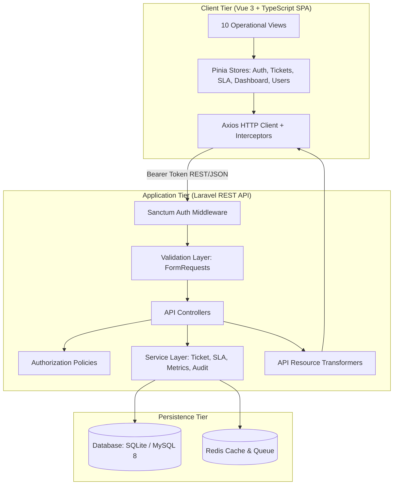

# OpsDesk — IT Service Desk & Operations Management Platform

[-emerald?style=flat-square&logo=php)](backend)
[](frontend)
[](frontend)
[](backend)
[](docker-compose.yml)

OpsDesk is an enterprise-grade internal IT support and incident management platform engineered for small and medium-sized businesses (SMBs). It replaces chaotic spreadsheets, email threads, and fragmented chat channels with a centralized, auditable command surface featuring strict SLA tracking, role-based workflows, and empirical operational analytics.

---

## 1. Business Problem & Solution

### The Challenge
Growing organizations often manage IT support requests through unstructured emails, Slack messages, or shared spreadsheets. This results in:
- Lost incidents and missed employee requests.
- Lack of accountability and unclear technician assignment.
- Undetected SLA breaches with zero visibility into response delays.
- Missing historical audit logs for compliance and ISO/SOC2 tracking.
- Absence of real operational data for IT capacity planning.

### The OpsDesk Solution
OpsDesk provides a structured, high-clarity single command platform:
- **Unique Incident Identifiers**: Deterministic ticket ribbons (`[OPS-2026-1001]`) in monospace for fast cross-referencing.
- **Automated SLA Engine**: Priority-tiered response and resolution countdown timers with proactive escalation alerts.
- **Dual Communication Feed**: Clean segregation between public requester conversation and confidential internal engineering notes.
- **Role-Based Workspaces**: Tailored user experiences for Requesters, Support Agents, Operations Managers, and System Administrators.
- **Empirical Analytics**: Live ECharts dashboards visualizing queue velocity, agent capacity, and SLA compliance rates directly from database transactions.

---

## 2. Seeded Demonstration Accounts

The database comes pre-seeded with realistic SMB operational records and dedicated test accounts for each of the 4 system personas. An instant **1-Click Demo Switcher** is also available on both the Login screen and the top application header.

| Persona / Role | Seeded Email | Password | Primary Capabilities |
|---|---|---|---|
| **System Administrator** | `admin@opsdesk.local` | `Password123!` | Full user governance, role assignments, SLA policies, global settings, queue access |
| **Support Agent** | `agent@opsdesk.local` | `Password123!` | Queue triage, status transitions, private internal notes, agent assignment |
| **Requester (Client)** | `requester@opsdesk.local` | `Password123!` | Incident submission, tracking personal requests, public dialogue with IT |
| **Operations Manager** | `manager@opsdesk.local` | `Password123!` | SLA monitoring board, agent workload capacity matrix, weekly trend analytics |

---

## 3. Technology Stack

### Backend
- **Framework**: Laravel 10.x (PHP 8.1+ host compatible; PHP 8.3 in Docker)
- **API Architecture**: RESTful API with FormRequests, API Resources, and Service Layer
- **Authentication**: Laravel Sanctum (Bearer Token)
- **Authorization**: Laravel Policies & Role-Based Gates
- **Database Support**: SQLite (zero-config host running) & MySQL 8.0 (Docker production)
- **Cache & Queue**: Redis / Sync
- **Test Suite**: PHPUnit (21 Feature/Unit tests, 72 assertions, 100% pass)

### Frontend
- **Framework**: Vue 3 (Composition API `<script setup lang="ts">`)
- **Language**: TypeScript 5.7+ (strict mode enabled)
- **Build Tool**: Vite 6
- **State Management**: Pinia
- **Routing**: Vue Router 4 with navigation guards and role-based route protection
- **Styling**: Tailwind CSS with Hallmark/Unslop CSS design tokens
- **Icons**: Lucide Icons (`lucide-vue-next`)
- **Data Visualization**: Apache ECharts (`vue-echarts`)

### Containerization & Tooling
- **Docker & Docker Compose**: Multi-container stack (App, Web, Frontend, MySQL 8, Redis, Queue Worker)
- **Web Server**: Nginx Alpine with fastcgi proxy and SPA fallback routing

---

## 4. System Architecture



---

## 5. UI/UX Design Direction & Hallmark / Unslop Alignment

OpsDesk was engineered following the **Design Engineering Directive**, adhering to the **Hallmark** and **Unslop** design principles:

1. **Operational Precision over Generic Slop**:
   - Zero decorative purple/pink gradients, glowing halos, or blurred blob overlays.
   - Fixed-width monospaced numeric figures (`font-variant-numeric: tabular-nums`) across all metrics, countdowns, and table rows to eliminate layout shifting.
2. **Single Source of Truth for Design Tokens**:
   - Every color, radius, border, and spacing value originates from declared CSS variables in `:root` (`src/assets/styles/tokens.css`).
   - Strict 4px spacing scale (`p-2`, `p-3`, `p-4`, `p-5`, `p-6`).
3. **Controlled Dark Neutral Palette**:
   - Deep obsidian background (`#0B0F17`) and matte dark titanium card surfaces (`#111827`, `#1F2937`).
   - Restrained cobalt `#2563EB` reserved exclusively for primary actions.
4. **Distinct Semantic Status & SLA Badges**:
   - Visual segregation between public requester conversation and confidential internal engineering notes (`bg-amber-950/15` with lock glyph).
   - Real-time SLA Countdown indicators showing Healthy, At-Risk (<30m warning), or Breached states with exact minute countdowns.
5. **Nine-Layer UNSLOP Redline Review**:
   - Independently verified across 9 passes: Spacing, Color, Icons, Copy, Typography, Layout, Details, Visual Authenticity, and Motion. Documented in [`docs/unslop-review.md`](docs/unslop-review.md).

---

## 6. Ten Core Operational Screens

| # | Screen | Target Persona | Key Capabilities |
|---|---|---|---|
| 1 | **Login & Authentication** | All | Secure Sanctum login, 1-click Demo Persona Switcher |
| 2 | **Operational Command Center** | All | Real-time queue volume, SLA compliance %, response averages, active incident feed |
| 3 | **Incident & Request Queue** | All | Tabular queue, multi-criteria filtering (status, priority, domain, agent), instant search, pagination |
| 4 | **Incident Command & Timeline** | All | Dual-feed (Public Replies vs. Confidential Internal Notes), status transitions, agent assignment, SLA countdowns, audit history |
| 5 | **Submit Incident Request** | Requesters & Staff | Priority impact selector with SLA hints, category picker, diagnostics description, simulated attachments |
| 6 | **Agent Workload & Capacity** | Managers & Admins | Specialist capacity matrix, benchmark progress bars, active vs. resolved metrics |
| 7 | **SLA Monitoring Board** | Staff & Managers | Proactive escalation board, threshold window filter (15m, 30m, 60m), at-risk & breached ticket alerts |
| 8 | **Analytics & Reports** | Managers & Admins | Apache ECharts visualizations: 7-day flow trend, domain distribution, compliance by severity |
| 9 | **User & Access Governance** | Admins & Managers | User directory, role assignment modal, account activation/deactivation toggles |
| 10 | **System Configuration & SLA Policies** | Admins | SLA response & resolution target editor, organization settings, warning thresholds |

---

## 7. Local Quickstart (Zero-Config Host Setup)

### Prerequisites
- PHP 8.1 or PHP 8.3 with `pdo_sqlite`, `mbstring`, `curl`
- Composer 2.x
- Node.js 18+ and npm

### 1. Backend Setup
```bash
cd backend

# 1. Initialize SQLite database & environment
cp .env.example .env
touch database/database.sqlite

# 2. Run database migrations and seed with authentic operational data
php artisan migrate:fresh --seed

# 3. Execute automated test suite (21 tests, 72 assertions)
php artisan test

# 4. Start local development API server
php artisan serve --port=8000
```
Backend API will be running at `http://localhost:8000/api/v1`.

### 2. Frontend Setup
In a new terminal:
```bash
cd frontend

# 1. Install frontend dependencies
npm install

# 2. Run TypeScript type check and build verification
npm run build

# 3. Start local development server
npm run dev
```
Open `http://localhost:5173` in your browser. Use the 1-click demo switcher to evaluate as Admin, Agent, Requester, or Manager!

---

## 8. Docker Compose Setup (Containerized Production)

To run the complete multi-container stack with PHP 8.3 FPM, Nginx, MySQL 8, and Redis:

```bash
# 1. Build and boot all containers in background
docker compose up -d --build

# 2. Run database migrations and seeders inside app container
docker compose exec app php artisan migrate:fresh --seed

# 3. Access applications:
# - Frontend SPA: http://localhost:3000
# - Backend API:  http://localhost:8000/api/v1
```

---

## 9. Automated Testing & Verification

The backend includes a comprehensive PHPUnit feature test suite covering authentication, permissions, ticket workflows, and SLA calculations:

```bash
cd backend && php artisan test
```

### Verified Scenarios:
- `AuthTest`: Login with valid/invalid credentials, Sanctum token issue, profile retrieval, logout.
- `TicketTest`: Ticket creation with auto-generated reference number (`OPS-YYYY-XXXX`), requester authorization, status transitions, agent assignment.
- `CommentTest`: Public comments vs. private internal notes; verifies requesters can never view confidential internal notes.
- `SlaTest`: Deadlines calculated according to priority policies; at-risk ticket detection.
- `RolePermissionTest`: Requesters blocked from unauthorized tickets; non-admins blocked from provisioning users or modifying SLA policies.
- `DashboardTest`: Verifies dashboard counters match actual database query aggregates.

---

## 10. Comprehensive Documentation Links

- [Design Direction & Brand Truth](docs/design-direction.md)
- [Design System & CSS Design Tokens](docs/design-system.md)
- [Nine-Layer UNSLOP Redline Review](docs/unslop-review.md)
- [UX Architecture & Persona Workflows](docs/ux-architecture.md)
- [System Architecture](docs/architecture.md)
- [Database Design & ERD](docs/database-design.md)
- [RESTful API Documentation](docs/api-documentation.md)
- [3-Month Development Roadmap](docs/development-roadmap.md)
