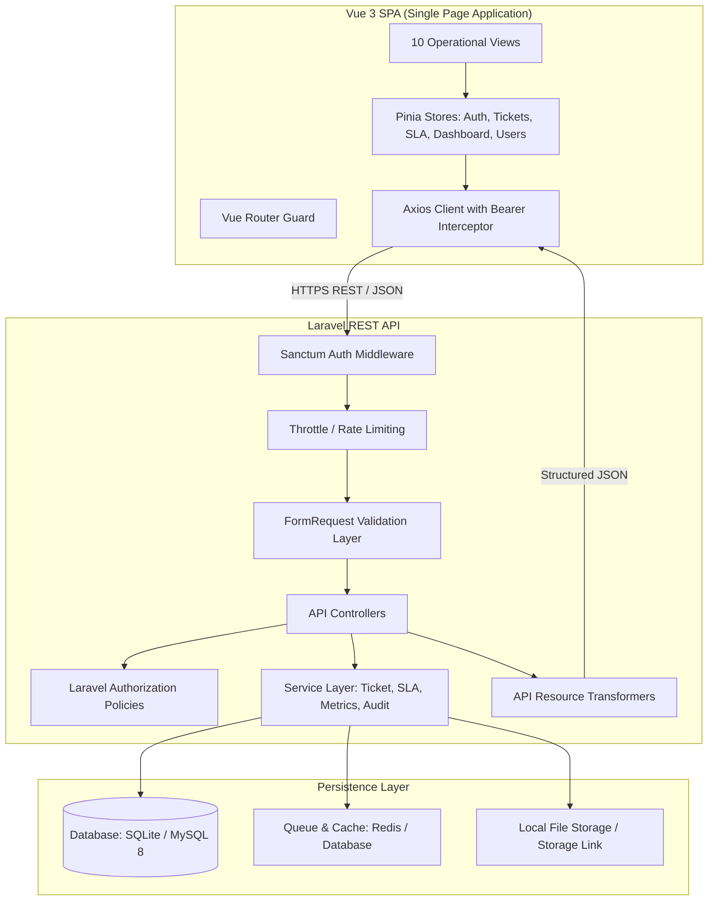

# OpsDesk — Architecture & System Design

## 1. System Overview

OpsDesk is engineered using a decoupled modern architecture:
- **Backend**: A robust RESTful API built on Laravel, implementing Sanctum token authentication, Service-Action architecture, FormRequest validations, API Resources, and Policy-based authorization.
- **Frontend**: A high-performance Single Page Application (SPA) built with Vue 3, TypeScript, Pinia, Vue Router, Tailwind CSS, Lucide Icons, and Apache ECharts.
- **Data & Infrastructure**: SQLite for fast zero-configuration host execution and testing; MySQL 8 + Redis for containerized Docker Compose production deployments.



---

## 2. Backend Design Patterns

### 2.1 Form Requests & Input Validation
Every write operation (POST, PUT, PATCH) is guarded by a dedicated `FormRequest`:
- Validates data types, string limits, enum constraints, foreign keys, and file upload parameters.
- Rejects invalid inputs before reaching controller logic, providing standardized RFC-7807 compliant error responses:
  ```json
  {
    "message": "The given data was invalid.",
    "errors": {
      "priority": ["The selected priority is invalid."]
    }
  }
  ```

### 2.2 Service Layer Architecture
To maintain skinny controllers and avoid code duplication:
- `TicketService`: Encapsulates ticket creation, unique reference generation (`OPS-YYYY-XXXX`), agent assignment, and state machine transitions.
- `SlaService`: Computes response and resolution due dates from SLA policies based on priority; evaluates breach status and identifies tickets at risk (<30 min remaining).
- `MetricService`: Gathers real-time operational aggregates for response time, resolution duration, SLA compliance percentages, and agent workload distribution.
- `AuditService`: Immutably logs state transitions, actor ID, old vs. new values, and timeline entries.

### 2.3 API Resources (Presentation Decoupling)
Database column names are never directly exposed to the frontend:
- Eloquent models are transformed through `JsonResource` classes (`TicketResource`, `CommentResource`, `UserResource`).
- Guarantees strict date formatting (ISO-8601 strings), calculated fields (e.g., `sla_remaining_minutes`, `is_at_risk`), and nested relationship inclusion.

### 2.4 Policy-Based Authorization
Strict server-side enforcement:
- `TicketPolicy`: Requesters can only access their own tickets; agents can access all assigned and unassigned tickets; admins and managers have global visibility.
- Private internal notes are filtered out at the query level for requesters.

---

## 3. Frontend Architecture

### 3.1 State Management (Pinia)
Shared reactive state is managed cleanly:
- `useAuthStore`: Authenticated user profile, token persistence, role helpers (`isAdmin`, `isAgent`, `isRequester`, `isManager`).
- `useTicketStore`: Active ticket list, pagination state, search and category filters, active ticket details.
- `useSlaStore`: SLA threshold tracking and countdown calculation.
- `useDashboardStore`: Operational metrics and chart datasets.

### 3.2 Responsive & Accessible Layouts
- Tested against 4 target viewport resolutions:
  - 1440px (Desktop Command Center)
  - 1280px (Standard Laptop)
  - 768px (Tablet)
  - 390px (Mobile)
- High contrast compliant typography, keyboard navigation focus indicators, and screen reader labels.
