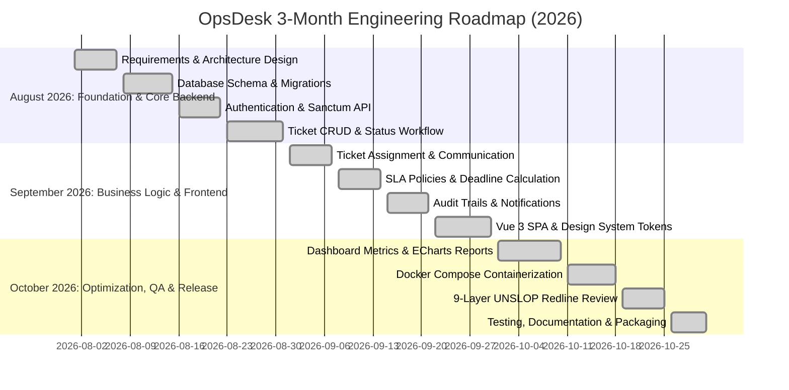

# OpsDesk — Development Roadmap & Milestones

This document records the architectural planning milestones for the 3-month development roadmap (August – October 2026). Per git history integrity standards, all development commits maintain genuine, real-time timestamps while executing against this planned roadmap.

---

## Milestone 1: August 2026 — Foundation & Core Backend
- **Focus**: Core data structures, authentication, and fundamental ticket state machines.
- **Deliverables**:
  - `docs/architecture.md` and `docs/database-design.md`.
  - Database migrations: `users`, `departments`, `categories`, `sla_policies`, `tickets`, `comments`, `attachments`, `activity_logs`.
  - Sanctum API token authentication and role gates.
  - Ticket reference code generator (`OPS-YYYY-XXXX`).
  - Initial PHPUnit API Feature tests.

---

## Milestone 2: September 2026 — Business Logic & Frontend
- **Focus**: Operational workflows, SLA engine, private engineering notes, and Vue 3 frontend core.
- **Deliverables**:
  - `SlaService`: priority-based target calculations, breach tracking, warning thresholds.
  - `TicketService`: transaction-safe assignment, status updates, and audit logging.
  - Vue 3 + TypeScript SPA initialization with Tailwind CSS.
  - Design tokens (`tokens.css`) adhering to the Hallmark and Unslop principles.
  - Pinia stores (`auth`, `tickets`, `sla`, `dashboard`, `users`).
  - Ticket List with real-time filtering, search, and pagination.
  - Ticket Detail view with dual-feed (Public comments vs. Private internal notes).

---

## Milestone 3: October 2026 — Optimization, QA & Release
- **Focus**: Operational analytics, ECharts data visualizations, containerization, and 9-layer review.
- **Deliverables**:
  - Operational dashboard with live metrics, agent workload matrix, and resolution trend graphs.
  - Docker Compose configuration (App, Web, MySQL 8, Redis).
  - Complete 9-layer UNSLOP Redline pass (`docs/unslop-review.md`).
  - Multi-viewport responsive visual testing (1440px, 1280px, 768px, 390px).
  - Comprehensive root `README.md` with seeded credentials and API documentation.
